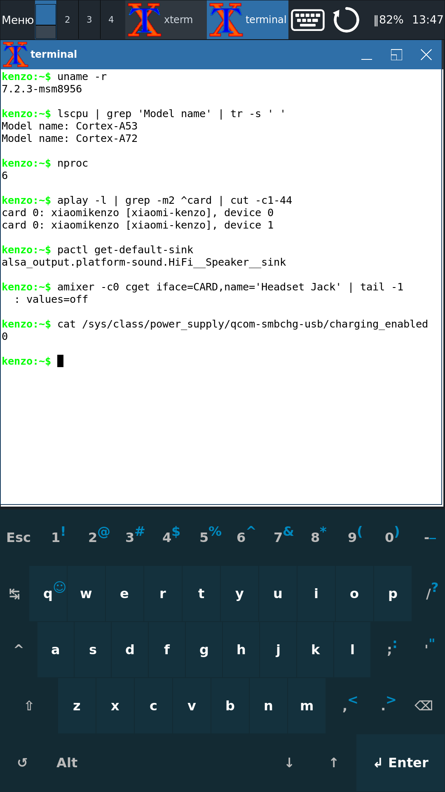
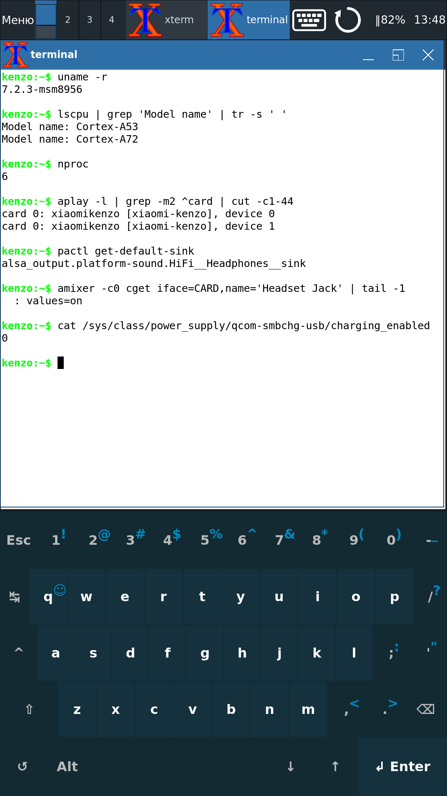

# Xiaomi Redmi Note 3 Pro (kenzo, MSM8956) on mainline Linux

Kernel patches, userspace configuration and small programs that make a Redmi Note 3 Pro usable on
[postmarketOS / Nura](https://nura.eco) edge with a mainline 7.2.3 kernel — most notably **working built-in audio**
(speaker, 3.5 mm headphones with plug detection, microphone, PipeWire), which the port did not have.

This is one person's test phone, not a maintained port. Everything here was checked on that one device
(2 GB / 16 GB variant).

  
  &nbsp;
  

Left: nothing in the jack — sound goes to the speaker. Right: headphones plugged in — PipeWire
moved to them by itself. On top the jwm panel with the battery indicator ("‖82%": on the charger, charging paused by
the charge limit) and the keyboard and rotate buttons; at the bottom the svkbd on-screen keyboard.

## Status (2026-11-10)

| | status | where |
|---|---|---|
| Display, GPU (Freedreno FD510), Wi-Fi, Bluetooth, battery, SD card | works (from the port) | [docs/device-notes.md](docs/device-notes.md) |
| Loudspeaker, 3.5 mm headphones, microphone, PipeWire | **works** | [kernel](kernel), [audio](audio), [docs/audio.md](docs/audio.md) |
| Headphones plugged in → sound moves to them, unplugged → back to the speaker | **works**, also during playback | [audio](audio) |
| Headset microphone and buttons, earpiece | not tested | |
| Touchscreen as a mouse: tap, drag, long-press right click, two-finger scroll | works (own daemon) | [input/touch](input/touch) |
| Power key: screen off/on, long press opens a menu | works (own daemon); no suspend on this kernel | [input/power](input/power) |
| Battery percentage in the jwm panel; terminal commands for volume, output, brightness, rotation | works | [battery](battery), [session](session) |
| Charge limit for a phone that lives on the charger: pause at 80 %, resume at 70 %, runs from the charger meanwhile | **works** (zennnez's kernel patch and daemon); a day-long test pending | [battery/charge-limit](battery/charge-limit) |
| Charger stops with "Charger error" (battery over-voltage bit at 4.08 V) and does not charge until toggled | **open problem** | [docs/device-notes.md](docs/device-notes.md) |
| Both Cortex-A72 cores enabled at boot | **under observation** — 3 unexplained reboots on 2026-11-09 | [docs/a72.md](docs/a72.md) |
| Hardware video decoding (Venus) | **does not work** — firmware loads, no frames | [docs/venus.md](docs/venus.md) |
| Camera, modem, sensors, LED, vibration | not in the port | |

## Layout

- [kernel/](kernel) — pmbootstrap recipe for `linux-postmarketos-qcom-msm8956` 7.2.3 release 18: 29 patches with
  their origin and status, config, build and install steps.
- [audio/](audio) — ALSA UCM, WirePlumber config and a jack hook, the `kenzo-audio-config` package, test tools.
- [input/touch](input/touch), [input/power](input/power) — touchscreen and power-key daemons (C, libevdev + XTest).
- [battery/](battery) — battery percentage for the jwm panel (C, Xlib + Xft) and the charge limit.
- [session/](session) — the X session (jwm, on-screen keyboard toggle, screen rotation) and terminal commands.
- [docs/](docs) — how the audio was brought up, the A72 story, Venus, device notes.

Code comments are mostly in Russian; READMEs and commit messages are in English.

## How this was made

Eduard Ryzhov ([@ryzed](https://github.com/ryzed)) directed the work, made the decisions and did everything that
needs hands and ears on the phone. Most of the code, the patches, the measurements on the device and these documents
were done by AI models:

- **Claude** (Anthropic, Claude Opus 5.5) — the lead: kernel patches, the daemons and scripts, the debugging on the
  phone, the documentation. Patches written this way carry `Assisted-by: Claude:claude-opus-5.5`.
- **DeepSeek** (DeepSeek V4.1 Flash) — research tasks: how the Android kernel talks to the ADSP, what similar
  devices do, why 24-bit audio was 48 dB too quiet, and the estimate that led to the headset-jack work.
- **GLM** (Z.ai, GLM-5.3) — reviews of the kernel patches and an independent analysis of the silent-speaker problem.

Because of that, nothing here was submitted to postmarketOS/Nura: their
[AI policy](https://docs.nura.eco/policies-and-processes/development/ai-policy.html) does not accept contributions
made with generative AI. Our patches have no `Signed-off-by`. Use them, test them, rewrite them.

## Credits

- **Magicxavi** — ADSP, SLIMbus and kenzo audio device-tree patches
  ([kenzo-mainline/kernel_mainline_msm8956](https://github.com/kenzo-mainline/kernel_mainline_msm8956), branch
  `7.2.3-kenzo`), the starting point for audio.
- **Lajosházi László Gergely** — the Fairphone 3 WCD9335 work: the codec init fix and the headset-jack (MBHC) series
  ([llg179org/linux](https://github.com/llg179org/linux)), used unchanged.
- **zennnez** — the A72 core numbering (cpu4/cpu7) and the `charging_enabled` charger patch (0029) in
  [zennnez/msm8956-mainline-linux](https://github.com/zennnez/msm8956-mainline-linux); the `kenzo-batteryd`
  charge-limit daemon in [zennnez/KenzoMainlineUbuntu](https://github.com/zennnez/KenzoMainlineUbuntu).
- **Viken Dadhaniya** — `qcom-ngd-ctrl` `disable_stream` (upstream).
- The [msm8956-mainline](https://codeberg.org/msm8956-mainline/linux) kernel and the postmarketOS/Nura port this all
  sits on.

## License

Kernel patches: GPL-2.0 ([LICENSES/GPL-2.0.txt](LICENSES/GPL-2.0.txt)), like the kernel; third-party patches keep
their authors. Everything else (daemons, scripts, configs, docs): MIT ([LICENSES/MIT.txt](LICENSES/MIT.txt)).

An earlier write-up about the A72 is in [this gist](https://gist.github.com/ryzed/76f5efeb2cdcba4d0eb74c571e775cbb);
its explanation of the instability turned out to be wrong — see [docs/a72.md](docs/a72.md).
